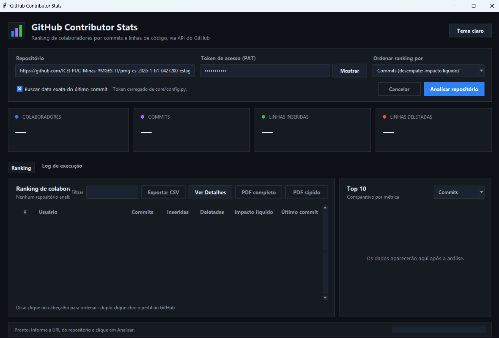
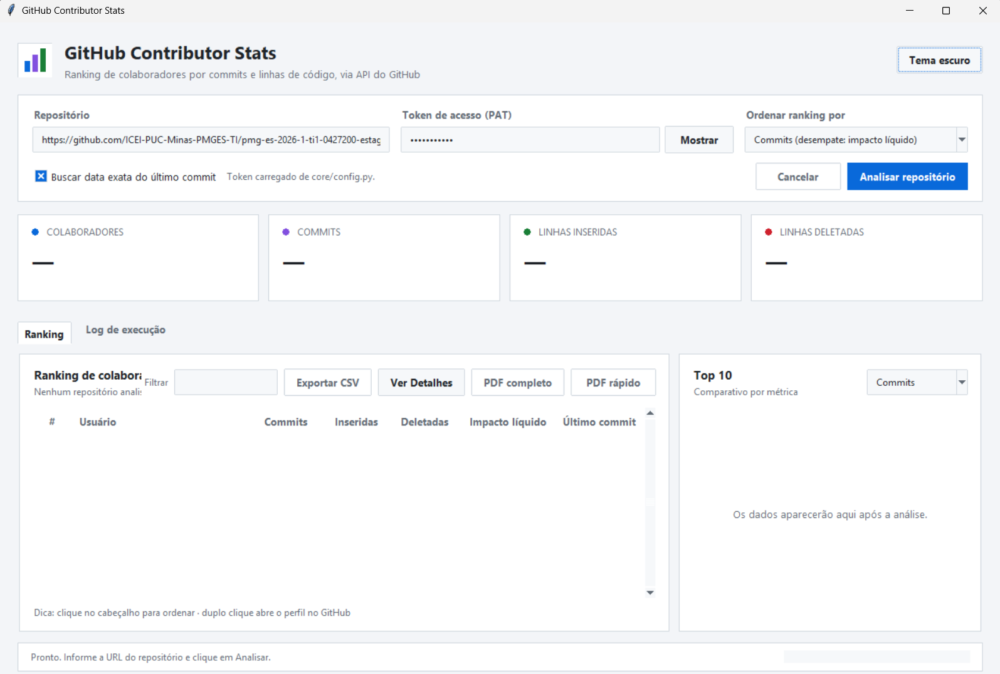

<h1>📊 Contributor Stats</h1>

  Aplicação desenvolvida em Python para analisar repositórios do GitHub,
  visualizar estatísticas de colaboradores e gerar relatórios detalhados.

  

  <strong>Python • Tkinter • GitHub REST API • ReportLab</strong>

<h2>📌 Sobre o projeto</h2>

  O <strong>Contributor Stats</strong> é uma ferramenta que permite analisar
  a participação dos colaboradores em repositórios do GitHub.

  A aplicação coleta dados diretamente da API do GitHub e apresenta
  um ranking de contribuição, estatísticas de código, gráficos,
  informações individuais e relatórios em PDF.

  O projeto possui uma interface gráfica desenvolvida com
  <strong>Tkinter e ttk</strong>, além de uma versão que pode ser
  executada diretamente pelo terminal.

<h2>🚀 Funcionalidades</h2>

<ul>
  <li>Análise de repositórios públicos e privados do GitHub.</li>
  <li>Ranking dos colaboradores por diferentes critérios.</li>
  <li>Quantidade de commits realizados.</li>
  <li>Total de linhas adicionadas e removidas.</li>
  <li>Cálculo do impacto líquido das contribuições.</li>
  <li>Identificação da última atividade dos colaboradores.</li>
  <li>Visualização de gráficos comparativos.</li>
  <li>Consulta de informações detalhadas de cada colaborador.</li>
  <li>Análise de Pull Requests, Issues e reviews.</li>
  <li>Informações sobre arquivos, diretórios e linguagens.</li>
  <li>Exportação dos dados para CSV.</li>
  <li>Geração de relatórios PDF individuais e gerais.</li>
  <li>Interface com temas claro e escuro.</li>
  <li>Registro do andamento das análises.</li>
</ul>

<h2>⚡ Otimizações de desempenho</h2>

  O projeto conta com melhorias para diminuir o tempo necessário
  para consultar informações do GitHub e gerar relatórios.

<ul>
  <li>
    <strong>Cache inteligente:</strong> reutiliza dados já consultados
    e reduz requisições repetidas.
  </li>
  <li>
    <strong>Consultas paralelas:</strong> permite analisar até três
    colaboradores simultaneamente na geração do PDF completo.
  </li>
  <li>
    <strong>Reaproveitamento de informações:</strong> evita consultar
    novamente dados compartilhados entre colaboradores.
  </li>
  <li>
    <strong>Tratamento de erros:</strong> lida com falhas de conexão,
    timeouts e respostas inesperadas da API.
  </li>
  <li>
    <strong>Interface responsiva:</strong> utiliza threads e filas
    para executar análises sem bloquear a janela principal.
  </li>
</ul>

<h2>📄 Relatórios PDF</h2>

<h3>1. PDF rápido</h3>

  Gera um relatório resumido utilizando as informações já coletadas
  na análise principal, evitando novas consultas à API.

<ul>
  <li>Identificação do repositório.</li>
  <li>Ranking dos colaboradores.</li>
  <li>Quantidade de commits.</li>
  <li>Linhas adicionadas e removidas.</li>
  <li>Impacto líquido.</li>
  <li>Estatísticas e gráficos gerais.</li>
</ul>

<h3>2. PDF completo</h3>

  Gera um relatório mais detalhado, incluindo informações adicionais
  dos colaboradores, como Pull Requests, Issues, reviews,
  histórico de atividade, arquivos e linguagens.

  Esse modo utiliza cache e processamento paralelo para
  reduzir o tempo de geração.

<h2>🖥️ Interface gráfica</h2>

O aplicativo possui uma interface com opções de tema claro e escuro.

  <h3>Tema escuro</h3>
  

  <h3>Tema claro</h3>
  

<h2>🛠️ Tecnologias utilizadas</h2>

<table>
  <tr>
    <th>Tecnologia</th>
    <th>Utilização</th>
  </tr>
  <tr>
    <td>Python</td>
    <td>Linguagem principal da aplicação.</td>
  </tr>
  <tr>
    <td>Tkinter / ttk</td>
    <td>Desenvolvimento da interface gráfica.</td>
  </tr>
  <tr>
    <td>GitHub REST API</td>
    <td>Coleta de informações dos repositórios.</td>
  </tr>
  <tr>
    <td>Requests</td>
    <td>Comunicação HTTP com a API.</td>
  </tr>
  <tr>
    <td>ReportLab</td>
    <td>Criação dos relatórios PDF.</td>
  </tr>
  <tr>
    <td>Threading</td>
    <td>Execução de tarefas em segundo plano.</td>
  </tr>
  <tr>
    <td>Concurrent Futures</td>
    <td>Processamento paralelo controlado.</td>
  </tr>
  <tr>
    <td>CSV</td>
    <td>Exportação de estatísticas.</td>
  </tr>
</table>

<h2>📁 Estrutura do projeto</h2>

<pre>
Contributor_stats/
│
├── assets/
│   ├── screenshot_gui_dark.png
│   └── screenshot_gui_light.png
│
├── core/
│   ├── config.py
│   ├── github_client.py
│   ├── service.py
│   ├── contributor_analysis.py
│   ├── activity_analysis.py
│   ├── file_analysis.py
│   ├── detail_cache.py
│   ├── pdf_generator.py
│   ├── ranking.py
│   ├── exporter.py
│   ├── models.py
│   ├── repo_url.py
│   └── exceptions.py
│
├── gui/
│   ├── app.py
│   ├── contributor_details.py
│   ├── activity_chart.py
│   ├── theme.py
│   └── widgets.py
│
├── main_gui.py
├── contributor_stats.py
├── test_optimizations.py
├── requirements.txt
└── README.md
</pre>

<h3>📦 Pasta core</h3>

Contém a lógica principal do projeto.

<ul>
  <li><code>config.py</code>: configurações da aplicação e token do GitHub.</li>
  <li><code>github_client.py</code>: comunicação com a API do GitHub.</li>
  <li><code>service.py</code>: coordenação da análise do repositório.</li>
  <li><code>contributor_analysis.py</code>: análise detalhada de colaboradores.</li>
  <li><code>activity_analysis.py</code>: análise de atividades ao longo do tempo.</li>
  <li><code>file_analysis.py</code>: funcionalidades relacionadas à análise de arquivos.</li>
  <li><code>detail_cache.py</code>: armazenamento temporário de dados analisados.</li>
  <li><code>pdf_generator.py</code>: geração dos relatórios PDF.</li>
  <li><code>ranking.py</code>: classificação dos colaboradores.</li>
  <li><code>exporter.py</code>: exportação para CSV.</li>
  <li><code>models.py</code>: estruturas de dados utilizadas pelo sistema.</li>
  <li><code>repo_url.py</code>: interpretação das URLs dos repositórios.</li>
  <li><code>exceptions.py</code>: tratamento de erros específicos.</li>
</ul>

<h3>🎨 Pasta gui</h3>

Contém os componentes da interface gráfica.

<ul>
  <li><code>app.py</code>: janela principal e interação com o usuário.</li>
  <li><code>contributor_details.py</code>: exibição dos detalhes dos colaboradores.</li>
  <li><code>activity_chart.py</code>: gráficos de atividade.</li>
  <li><code>theme.py</code>: estilos e temas da aplicação.</li>
  <li><code>widgets.py</code>: componentes visuais reutilizáveis.</li>
</ul>

<h2>⚙️ Pré-requisitos</h2>

Antes de executar o projeto, instale:

<ul>
  <li>Python 3.9 ou superior.</li>
  <li>Git, caso deseje clonar o repositório.</li>
  <li>Visual Studio Code ou outro editor de sua preferência.</li>
  <li>Conexão com a internet para consultar a API do GitHub.</li>
</ul>

  Download do Python:
  <a href="https://www.python.org/downloads/">python.org/downloads</a>

  Durante a instalação no Windows, habilite a opção
  <strong>Add Python to PATH</strong>, quando disponível.

<h2>📥 Instalação do projeto</h2>

<h3>1. Clonar o repositório</h3>

<pre><code>git clone URL_DO_SEU_REPOSITORIO
</code></pre>

Depois, entre na pasta do projeto:

<pre><code>cd Contributor_stats
</code></pre>

  Caso tenha baixado o projeto em ZIP, basta extrair os arquivos
  e abrir a pasta no terminal.

<h3>2. Verificar a instalação do Python</h3>

<pre><code>python --version
</code></pre>

Se o comando não funcionar no Windows, tente:

<pre><code>py --version
</code></pre>

<h3>3. Criar o ambiente virtual (.venv)</h3>

  O ambiente virtual permite instalar as dependências do projeto
  separadamente das bibliotecas globais do computador.

<pre><code>python -m venv .venv
</code></pre>

  Se necessário, utilize <code>py -m venv .venv</code>.

<h3>4. Ativar o ambiente virtual</h3>

<strong>Windows - CMD:</strong>

<pre><code>.venv\Scripts\activate.bat
</code></pre>

<strong>Windows - PowerShell:</strong>

<pre><code>.\.venv\Scripts\Activate.ps1
</code></pre>

<strong>Linux / macOS:</strong>

<pre><code>source .venv/bin/activate
</code></pre>

  Quando o ambiente estiver ativo, o terminal deverá apresentar
  <code>(.venv)</code> antes do caminho da pasta.

<h3>5. Atualizar o pip</h3>

<pre><code>python -m pip install --upgrade pip
</code></pre>

<h3>6. Instalar as dependências</h3>

<pre><code>python -m pip install -r requirements.txt
</code></pre>

  O arquivo <code>requirements.txt</code> contém as bibliotecas
  externas necessárias:

<pre><code>requests&gt;=2.31
reportlab&gt;=4.0
</code></pre>

  Também é possível instalá-las individualmente:

<pre><code>python -m pip install requests reportlab
</code></pre>

  O Tkinter faz parte da instalação padrão do Python no Windows.
  Não é necessário instalá-lo pelo pip.

<h2>🔑 Configuração do token do GitHub</h2>

  Para consultar repositórios privados, é necessário utilizar
  um token com as permissões adequadas.

  O token também ajuda a aumentar o limite de requisições
  disponíveis para consultas autenticadas.

  Gere seu token em:
  <a href="https://github.com/settings/tokens">
    GitHub Personal Access Tokens
  </a>

  É recomendado configurar o token por uma variável de ambiente,
  evitando armazená-lo diretamente no código-fonte.

<strong>Windows - PowerShell:</strong>

<pre><code>$env:GITHUB_TOKEN="SEU_TOKEN_AQUI"
</code></pre>

<strong>Windows - CMD:</strong>

<pre><code>set GITHUB_TOKEN=SEU_TOKEN_AQUI
</code></pre>

  Essa configuração vale para a sessão atual do terminal.
  O arquivo <code>core/config.py</code> também possui configurações
  relacionadas ao token.

  <strong>Atenção:</strong> não publique tokens reais no GitHub.
  Caso exista um token fixo em <code>core/config.py</code>,
  remova-o antes de publicar o repositório.

<h2>▶️ Como executar</h2>

<h3>1. Interface gráfica</h3>

  Com o ambiente virtual ativado e as dependências instaladas,
  execute:

<pre><code>python main_gui.py
</code></pre>

  A janela principal será aberta. Informe a URL do repositório,
  configure o token quando necessário e inicie a análise.

<h3>2. Interface de linha de comando (CLI)</h3>

  Também é possível analisar um repositório diretamente pelo terminal.

<pre><code>python contributor_stats.py https://github.com/usuario/repositorio
</code></pre>

Exemplo utilizando apenas o identificador do repositório:

<pre><code>python contributor_stats.py usuario/repositorio
</code></pre>

<h3>3. Opções adicionais da CLI</h3>

Exibir a ajuda dos comandos:

<pre><code>python contributor_stats.py --help
</code></pre>

Mostrar os 15 principais colaboradores:

<pre><code>python contributor_stats.py usuario/repositorio --top 15
</code></pre>

Ordenar por impacto líquido:

<pre><code>python contributor_stats.py usuario/repositorio --sort impacto
</code></pre>

Exportar para um arquivo CSV específico:

<pre><code>python contributor_stats.py usuario/repositorio --output ranking.csv
</code></pre>

Evitar a busca de datas exatas para acelerar a análise:

<pre><code>python contributor_stats.py usuario/repositorio --no-exact-dates
</code></pre>

<h2>🧪 Executando os testes</h2>

  O projeto possui testes relacionados às otimizações implementadas.

<pre><code>python -m unittest test_optimizations.py -v
</code></pre>

  Os testes ajudam a verificar o funcionamento do cache,
  o processamento de colaboradores e a geração de relatórios.

<h2>🛑 Desativando o ambiente virtual</h2>

Quando terminar de utilizar o projeto, execute:

<pre><code>deactivate
</code></pre>

<h2>🧹 Comandos úteis</h2>

Listar bibliotecas instaladas:

<pre><code>python -m pip list
</code></pre>

Verificar as dependências:

<pre><code>python -m pip check
</code></pre>

Atualizar as dependências do projeto:

<pre><code>python -m pip install --upgrade -r requirements.txt
</code></pre>

<h2>❗ Problemas comuns</h2>

<h3>ModuleNotFoundError</h3>

  Geralmente ocorre quando uma biblioteca não foi instalada
  ou quando o ambiente virtual não está ativo.

<pre><code>python -m pip install -r requirements.txt
</code></pre>

<h3>Erro ao ativar o .venv no PowerShell</h3>

  Caso a execução de scripts esteja bloqueada, utilize o CMD
  para ativar o ambiente ou configure a política apenas para
  a sessão atual:

<pre><code>Set-ExecutionPolicy -Scope Process -ExecutionPolicy Bypass
</code></pre>

Depois, execute novamente:

<pre><code>.\.venv\Scripts\Activate.ps1
</code></pre>

<h3>Erro 403 na API do GitHub</h3>

  Pode indicar limite de requisições, falta de permissão
  ou restrições de acesso. Verifique o token e aguarde
  quando necessário.

<h3>PDF demorando para gerar</h3>

  O PDF completo realiza consultas adicionais e pode levar
  mais tempo em repositórios grandes. Utilize o PDF rápido
  quando precisar apenas do ranking e das estatísticas gerais.

<h2>🔒 Segurança</h2>

<ul>
  <li>Não compartilhe seu token pessoal.</li>
  <li>Não envie credenciais para repositórios públicos.</li>
  <li>Utilize tokens com as permissões mínimas necessárias.</li>
  <li>Não versione a pasta <code>.venv</code>.</li>
  <li>Revogue imediatamente qualquer token exposto.</li>
</ul>

<h2>📚 Objetivo do desenvolvimento</h2>

  O Contributor Stats foi desenvolvido para explorar conceitos
  de integração com APIs REST, processamento de dados,
  programação modular, interfaces gráficas e geração de relatórios.

  O projeto também aplica técnicas de otimização,
  como cache, paralelismo controlado e processamento
  em segundo plano.

<h3>👨‍💻 Desenvolvedor</h3>

<strong>Arthur Moraes</strong>

Engenharia de Software | PUC Minas

Desenvolvido com Python 🐍

